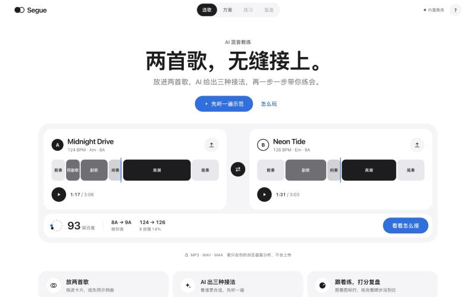
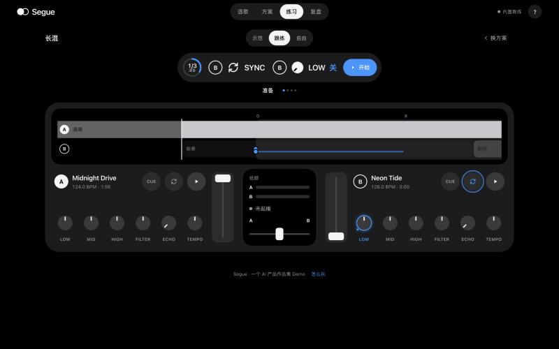

# Segue · AI 混音教练

**两首歌，无缝接上。**

Segue 是一个给 DJ 新手的混音练习台。放进两首歌，AI 给出三种接法，再一步一步带你练会，最后打分复盘。

> 一个 AI 产品经理作品集 Demo：纯前端、零部署、单文件可运行。



## 打开方式

| 方式 | 怎么做 | AI 点评 |
| --- | --- | --- |
| 单文件 | 下载 [`dist/segue.html`](dist/segue.html)，双击用 Chrome / Safari 打开 | 内置教练 |
| 本地服务 | 在仓库根目录运行 `python3 -m http.server 8765`，打开 `http://localhost:8765/dist/segue.html` | 内置教练 |
| claude.ai Artifact | 在 claude.ai 里打开发布的 Artifact | Claude 实时生成 |

不需要账号、不需要后端。歌曲只在浏览器里解码和分析，不会上传。自带两首浏览器实时合成的示例曲（无采样、无版权音频），打开就能玩。

## 一次完整的练习

1. **选歌**：拖进两首歌，或直接用示例曲。自动测出 BPM、调性、段落和乐句，给出契合度。
2. **方案**：同一对歌给出三种接法（长混 Bass Swap / 滤波推进 Filter Ride / 回声收尾 Echo Out），每种都画成一张“谁在主导”的示意图，并给出适合度和推荐。
3. **练习**：黑色舞台上的双 Deck 调音台。教练卡片用控件图标告诉你下一步拧哪里、还有几拍；三种模式：示范（看 AI 演一遍）、跟练（计分）、自由（随便玩）。
4. **复盘**：总分 + 五项指标（节拍对齐、乐句时机、低频干净、音量平稳、动作到位），逐步点评，你和示范的推子曲线对比，以及“下次试试”的一个具体动作。





## AI 在这里做什么

产品里把“确定的事”和“需要说人话的事”分开：

| 规则引擎（`planner.js` / `analysis.js`） | Claude（`Coach` 模块） |
| --- | --- |
| 测速度、找拍点和乐句、分段 | 看完三种方案，用一句话说为什么推荐这一种 |
| 按两首歌的结构排出三种方案和时间点 | 读完打分数据，写一句复盘：听众会听到什么、下次做什么 |
| 逐帧记录操作、打分 | 回答新手问题（带着当前两首歌和方案的上下文） |

- 打分必须可复现，所以交给规则；语言需要因人而异，所以交给模型。
- Claude 不可用时，同样的位置由内置教练（规则模板 + FAQ）接管，流程完全一样。
- 界面上只有 Claude 真正生成的内容才标“Claude”；AI 示范叫“示范”，系统兜底帮按叫“帮你按”。不把规则包装成 AI。

## 设计取舍

- **苹果官网式黑白**：浅色页面做选择，黑色舞台做练习；唯一的彩色是教练蓝。
- **图标代替说明**：所有指令都是“Deck 徽章 + 控件图标 + 目标值”，不写长句。
- **圆角段落条代替波形**：新手看不懂波形，但看得懂“前奏 / 副歌 / 高潮”。
- **动效**：ease-out、按压 0.97 缩放、仅在精确指针设备上做 hover，尊重减少动态效果设置。

## 文件结构

```
index.html        页面、样式、视图结构（Artifact 源文件，外壳由宿主补齐）
js/engine.js      Web Audio 双 Deck 引擎（EQ、滤波、回声、推子、量化起播）
js/analysis.js    BPM / 调性 / 段落 / 乐句分析，Camelot 契合度
js/planner.js     三种方案生成、逐帧打分、Coach（Claude + 内置教练）
js/synth.js       两首示例曲的离线合成
js/ui.js          视图、调音台控件、教练卡片、复盘
tools/build.py    把所有脚本内联成 dist/segue.html
```

修改后运行 `python3 tools/build.py` 重新生成单文件版。在地址后加 `?mute` 可以静音运行（仪表和打分照常）。

## 已知限制

- 练习台为桌面和横屏平板设计；手机可以浏览和看示范，但精细操作不便。
- 分析针对 4/4 拍、节奏稳定的电子乐；1 分钟以下或拍子太乱的歌会被拒绝。
- 调性检测是简化算法，个别歌曲可能不准，不影响练习流程。

## License

MIT
