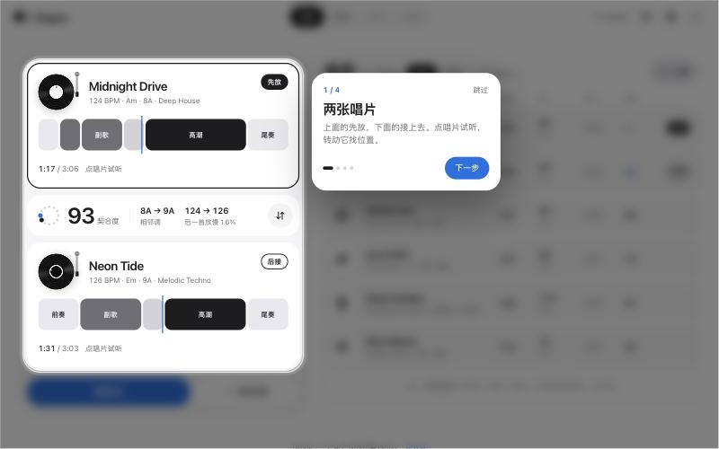
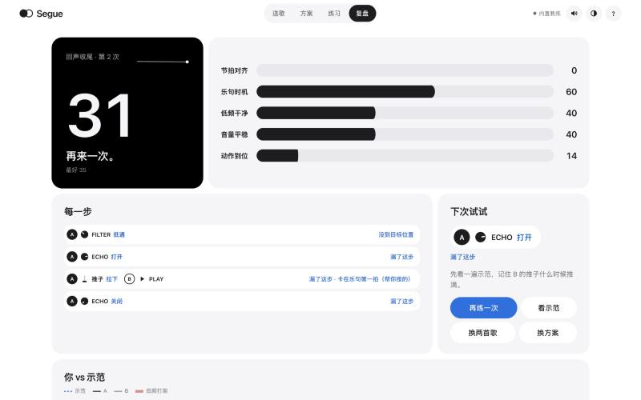

# Segue · AI 混音教练

Segue 是一个给 DJ 新手的混音练习台。放进两首歌，AI 给出三种接法，再一步一步带你练会，最后打分复盘。

> 一个 AI 产品经理作品集 Demo：纯前端、零部署、单文件可运行。


## 打开方式

| 方式 | 怎么做 | AI 点评 |
| --- | --- | --- |
| 单文件 | 下载 [`dist/segue.html`](dist/segue.html)，双击用 Chrome / Safari 打开 | 内置教练 |
| 本地服务 | 在仓库根目录运行 `python3 -m http.server 8765`，打开 `http://localhost:8765/dist/segue.html` | 内置教练 |
| claude.ai Artifact | 在 claude.ai 里打开发布的 Artifact | Claude 实时生成 |

不需要账号、不需要后端。歌曲只在浏览器里解码和分析，不会上传。自带一个 6 首歌的曲库，全部由浏览器实时合成（无采样、无版权音频），打开就能玩。

## 一次完整的练习

一张“接歌谱”贯穿后三步：上下两条轨道是 A 和 B，每个动作标在它发生的那一小节上。

1. **选歌**：页面没有标语，打开就是内容。左边是这一对（先放的一首、后接的一首，和它们的契合度），右边是曲库。先选中一张唱片，点曲库里的一首歌就放上去，也可以把歌拖到唱片上；上传的歌也进曲库，成为一行。每台是一张带唱针的黑胶唱片：点唱片试听，转动唱片找位置。
2. **接法**：页面主体是当前接法的谱：两首歌在哪一小节叠上、哪一小节换低音、每个旋钮什么时候动。下面三张卡切换长混 / 滤波推进 / 回声收尾，Claude 说明推荐理由和新手易错点。
3. **练习**：同一张谱在黑色舞台上滚动。教练卡片用控件图标告诉你现在做什么、接着做什么；两边是两台唱机，点唱片播放或暂停，播放中转动唱片可以把它推快或拖慢来对拍；两个音量推子并排在中间的调音台里，和真机一样。三种模式：示范、跟练（计分）、自由。
4. **复盘**：只给一件事——最弱的那个动作、一句点评，以及“只练这几小节”：从那一步前 4 小节起播，台子自动摆好，练完当场告诉你这一步做得怎样。下面是你的操作和谱的对比、五项评分、逐步结果。

第一次打开时有一段 4 步引导：每一步的说明卡贴在它讲的那块界面旁边，其余部分调暗并虚化；可以跳过，之后从右上角的问号里重看。






## 曲库

| 曲目 | 风格 | BPM | 调 |
| --- | --- | --- | --- |
| Midnight Drive | Deep House | 124 | Am · 8A |
| Neon Tide | Melodic Techno | 126 | Em · 9A |
| Velvet Line | Disco House | 122 | Cm · 5A |
| Low Orbit | Tech House | 127 | Gm · 6A |
| Glass Garden | Progressive House | 128 | F♯m · 11A |
| Slow Bloom | Organic House | 114 | Dm · 7A |

六首歌的速度、调性和段落结构各不相同，换一对就能看到推荐变化：比如 Midnight Drive 接 Slow Bloom 速度差 8.8%，推荐会从长混变成回声收尾。曲库歌曲自带调性标签，上传的歌由分析器测。

## 其他细节

- 右上角：音量 / 静音（记住上次的设置）、外观（跟随系统 / 浅色 / 深色）、帮助。
- 快捷键：`Enter` 开始 / 停止，`空格` B 播放，`S` 同步，`M` 静音，`?` 帮助。
- 练习记录存在本机：复盘页显示第几次、最好分和最近的分数走势，接法卡上显示练过几次。
- 切到后台标签页时练习会自动停止，不计分。

## AI 在这里做什么

产品里把“确定的事”和“需要说人话的事”分开：

| 规则引擎（`planner.js` / `analysis.js`） | Claude（`Coach` 模块） |
| --- | --- |
| 测速度、找拍点和乐句、分段 | 看完三种方案，用一句话说为什么推荐这一种 |
| 按两首歌的结构排出三种方案和时间点 | 读完打分数据，写一句复盘：听众会听到什么、下次做什么 |
| 逐帧记录操作、打分 | 回答新手问题（带着当前两首歌和方案的上下文） |

- 打分必须可复现，所以交给规则；语言需要因人而异，所以交给模型。
- Claude 不可用时，同样的位置由内置教练（规则模板 + FAQ）接管，流程完全一样。
- 界面上只有 Claude 真正生成的内容才标“Claude”；AI 示范叫“示范”，系统兜底帮按叫“帮你按”。不把规则包装成 AI。

## 设计取舍

- **苹果官网式黑白**：浅色页面做选择，黑色舞台做练习；唯一的彩色是教练蓝。
- **图标代替说明**：所有指令都是“Deck 徽章 + 控件图标 + 目标值”，不写长句。
- **圆角段落条代替波形**：新手看不懂波形，但看得懂“前奏 / 副歌 / 高潮”。
- **动效**：ease-out、按压 0.97 缩放、仅在精确指针设备上做 hover，尊重减少动态效果设置。

## 文件结构

```
index.html        页面、样式、视图结构（Artifact 源文件，外壳由宿主补齐）
js/engine.js      Web Audio 双 Deck 引擎（EQ、滤波、回声、推子、量化起播）
js/analysis.js    BPM / 调性 / 段落 / 乐句分析，Camelot 契合度
js/planner.js     三种方案生成、逐帧打分、Coach（Claude + 内置教练）
js/synth.js       曲库：6 首示例曲的离线合成
js/ui.js          视图、调音台控件、教练卡片、复盘
tools/build.py    把所有脚本内联成 dist/segue.html
```

修改后运行 `python3 tools/build.py` 重新生成单文件版。在地址后加 `?mute` 可以静音运行（仪表和打分照常）。

## 已知限制

- 练习台为桌面和横屏平板设计；手机可以浏览和看示范，但精细操作不便。
- 分析针对 4/4 拍、节奏稳定的电子乐；1 分钟以下或拍子太乱的歌会被拒绝。
- 调性检测是简化算法，容易判到邻近调（差一格 Camelot），不影响练习流程。

## License

MIT
